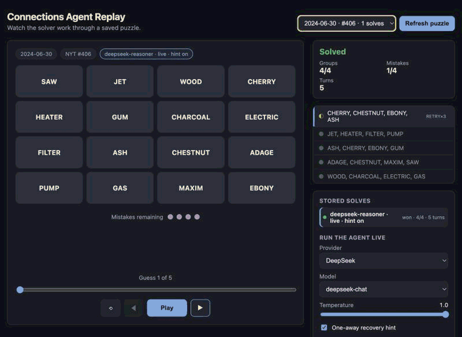
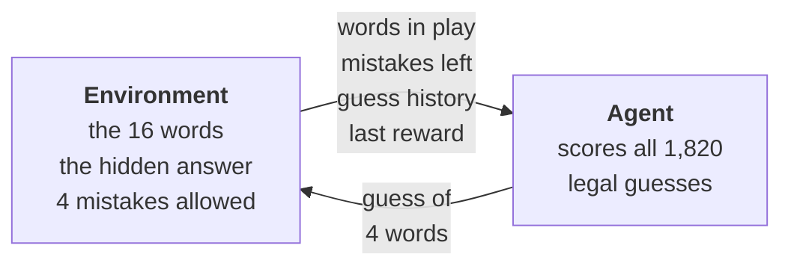
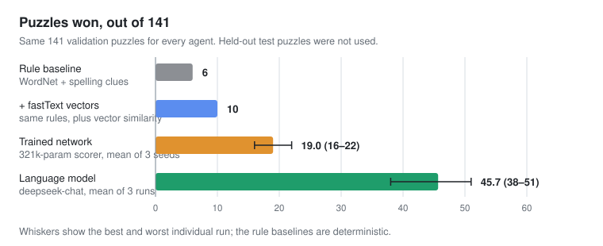
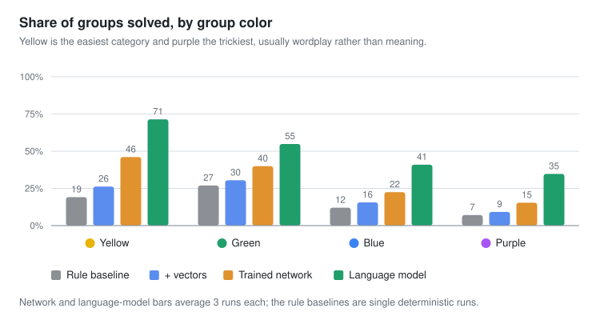
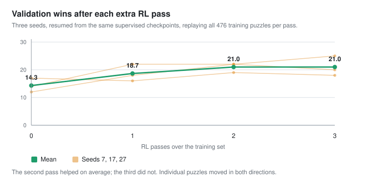

# Connections RL

Four different agents that try to solve [NYT Connections](https://www.nytimes.com/games/connections), the game where you sort sixteen words into the four groups of four that belong together, played against 717 real archived puzzles.

I play Connections most mornings, and I was learning reinforcement learning at the time, so I wanted to combine the two. I was curious how a frontier model like Opus 5.5 would do, tried it, and it solved them. That's when the smaller models got interesting: if it's easy for a big model, how far can a small one get, and how much of that can training buy?

Connections is a good place to ask. There are 1,820 legal moves on a fresh board, the feedback you get back is thin, and because a person can solve the puzzle you can usually tell *why* an agent failed.

The four agents share one environment, one data split and one scoreboard, and differ only in how they pick a guess: hand-written clue rules, those rules plus pretrained word vectors, a small neural network trained with supervised learning and then reinforcement learning, and a language model playing the same game as a reference point.

What came out of it: the limit is what the agent's inputs can represent, not how long it trains. More on that below.

## The replay app

I built a web app so I could watch the agents play instead of reading result tables. It runs locally, browses every saved puzzle, and replays an agent solving it one guess at a time: the board, the agent's reasoning for that guess, the NYT-style "one away" nudge, and groups dropping in with their real color. It can also run an agent live against a puzzle you pick.



That run is `deepseek-reasoner` on the puzzle for June 30, 2024. It opens with ASH · CHERRY · CHESTNUT · EBONY, reasoning "types of wood", and is told it is one away. Rather than guess again at the same group, it banks a different one it is sure of (hot tub components), then comes back with CHESTNUT swapped for GUM and takes the rest of the board apart: trees, old sayings, grill fuels. One mistake, four groups.

[Running it](webapp/README.md) takes two terminals and no API key, unless you want to watch a live solve.

## How it works

A puzzle is sixteen words plus the four groups they actually belong to. The environment holds those groups and never shows them to the agent, which is what makes this a game rather than a sorting exercise: the only way to learn anything about the answer is to guess and be graded. It shuffles the words, takes one guess at a time, and replies the way the real game does: correct (revealing that group's color and category), **one away** (exactly three of your four belong together, the strongest hint in the game), or wrong. Four mistakes and the game is over.



Every agent sees exactly the same observation and none of them can see the groups. What differs is how each one turns 1,820 legal four-word combinations into a single guess:

| Agent | How it picks |
| --- | --- |
| **Rule baseline** | Hand-written clue rules: shared WordNet synsets and hypernyms, shared prefixes/suffixes, one-letter edits. No learning. |
| **+ fastText vectors** | The same rules, plus cosine similarity from pretrained fastText word vectors. |
| **Trained network** | A 321,793-parameter scorer over pooled word vectors, clue summaries and the game history. Supervised warm start on real groups, then DQN updates from playing training puzzles. |
| **Language model** | A language model given the same observation in prose, replying with a four-word JSON guess. Not an RL agent, but a reference point and an upper bound. |

The 717 puzzles are split chronologically: 476 for training (through September 2024), 141 for validation (October 2024 – February 2025), and **100 held-out test puzzles that nothing below has ever touched**. Every number here is a validation number.

## Results



The first three agents all work the same way underneath. Each one describes a candidate guess with a handful of hand-chosen measurements, called features: do these four words share a WordNet category, a prefix, a similar word vector? Then it scores the guess from those numbers. All three lose most of their games. The rule baseline wins 6 of 141. Adding vectors buys four more wins. Training a network on top of those same features roughly triples the baseline, to 19 wins on average. That is real progress, and still a loss rate above 85%. The language model wins 45.7 on average, about a third of the board, playing the identical game through the identical environment.

### The purple problem

Connections colors its categories by difficulty: yellow is the gentlest, purple is usually wordplay (hidden words, homophones, "___ CHIP") rather than meaning.



This is the finding the whole project turns on. Every agent degrades from yellow to purple, which is expected, since that is what the colors mean. What is not expected is the *shape* of the fall. The feature-based agents collapse: the trained network solves 46% of yellow groups and 15% of purple ones, and before its first guess only 4, 2 and 0 of the 141 purple groups rank in its top ten candidates, depending on the seed. The language model holds 35% on purple.

That gap is not a learning gap. WordNet and word vectors encode what words *mean*; purple groups are built on how words are *spelled and sounded*. The clue features simply do not represent the thing being asked about, so no amount of training on them recovers it. Better inputs, not a bigger learner.

### More RL helps, then stops



Resuming three supervised checkpoints and replaying all 476 training puzzles gains most of its ground in the first pass, a little more in the second, and nothing in the third. Individual puzzles moved in both directions throughout. Crucially, extra RL did *not* improve purple recognition. It got slightly worse, which is the same message from a different angle.

### What else came out of it

- **The network couldn't take a hint.** A "one away" proves three of your four words belong together. Across a seed-7 validation run the network kept three of the four on only 24 of 180 follow-up guesses, and 41 of its 54 one-group losses contained a one-away it then walked away from. An inference-time recovery policy is the clearest unclaimed win here.
- **RL did learn to use negative feedback.** The share of follow-ups reusing three or more words from a guess already known to be wrong fell from 326/643 to 69/612 after DQN. That inference is free and the network picked it up.
- **One language-model run tells you very little.** Three runs of the same model on the same 141 puzzles won 51, 38 and 48. Only 21 puzzles were won every time; 72 were won at least once. Any comparison of two configurations needs repeats to mean anything.
- **It's cheap.** A full 141-puzzle validation run with `deepseek-chat` costs about $0.11.

Full method, per-seed tables and per-turn traces: [baselines and the network](docs/baselines-and-network.md), [the language-model agent](docs/llm-agent.md), [the puzzle data](docs/data.md), [the environment](docs/environment.md). Every number above is regenerated from the JSON in `reports/` by `scripts/make_charts.py`.

## Run it

Set up and play one puzzle with the rule baseline:

```sh
python3 -m venv .venv
.venv/bin/python -m pip install -e '.[wordnet]'
.venv/bin/python -m nltk.downloader -d .venv/nltk_data wordnet
.venv/bin/python -m connections_rl.demo --show-top 3
```

That solves a small synthetic puzzle and prints the clues behind each guess: a smoke test for the environment, not evidence of anything. Run the tests with `python3 -m unittest discover -s tests`.

For the replay app, see [webapp/README.md](webapp/README.md). For the heavier paths (building the fastText vector cache, training the network, running the language model against the benchmark), see the docs linked above. A language-model run calls a paid API and costs money; start with `--limit`.

## Credits

The puzzles are The New York Times'. Connections is created and owned by the NYT; this is an independent personal research project, is not affiliated with or endorsed by them, and is not sold, monetized or ad-supported. The archived puzzles live here so the experiments are reproducible. If you enjoy the game, [play it at the source](https://www.nytimes.com/games/connections).

Also used: [fastText](https://fasttext.cc/docs/en/crawl-vectors.html) pretrained English vectors (CC BY-SA 3.0, downloaded separately and kept out of Git), [NLTK's WordNet corpus](https://www.nltk.org/howto/wordnet.html), and the [Eyefyre answer archive](https://github.com/Eyefyre/NYT-Connections-Answers), used to cross-check the ingested puzzles.
